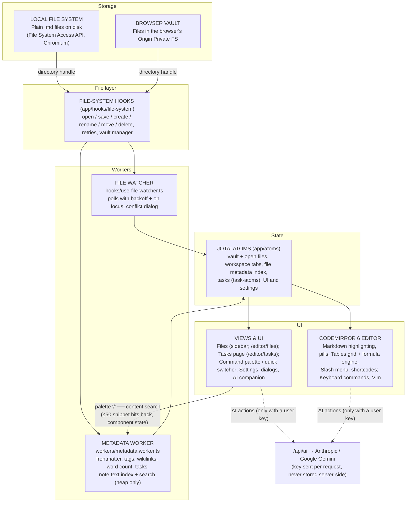

# HermesMarkdown System Architecture

This document describes the runtime data flow of the editor.

## System Architecture & Data Flow



## Architectural Principles

1. Markdown files remain the canonical source of truth.
2. The metadata index, task lists and the note-text index are rebuildable derived state. The note-text index lives in worker memory only and is rebuilt each session.
3. CodeMirror structural mutations (tables, list indent, task cycling) are dispatched as atomic transactions, so each is one undo step.
4. External file changes are detected and surfaced through the conflict dialog — local edits are never replaced silently.
5. Jotai atoms expose indexed state to the editor and views.
6. Network access is opt-in: only AI actions (with a user-supplied key) talk to the server routes. Git runs outside the browser, on the vault folder.

## Runtime Components

- **Local file system:** User-selected Markdown vault accessed through the File System Access API (Chromium). Handles are persisted in IndexedDB (`app/services/idb.ts`).
- **Browser vaults:** Vaults kept in the Origin Private File System (`app/services/opfs.ts`, `app/hooks/file-system/use-browser-vault.ts`) for browsers without disk folder access (Safari, iOS, Firefox). They use the same handle-based file layer. Writes go through `app/services/file-writer.ts`, which falls back to `app/workers/opfs-writer.worker.ts` where `createWritable()` is missing. Whole-vault zip export / import lives in `app/services/vault-archive.ts`.
- **Offline app:** `public/sw.js` (registered by `app/components/ServiceWorkerRegister.tsx` in production) serves navigations network-first with a cached shell, and hashed `/_next/static` assets cache-first. It never touches `/api/*`.
- **Git:** not handled in the browser. A disk vault can be a git repository; `.git` and tool folders are skipped by the scan (`vault-scan.ts`).
- **File-system hooks:** `app/hooks/file-system/` implements open, save (with retries), create, rename, move, duplicate, and delete, plus the vault manager.
- **File watcher:** `app/hooks/use-file-watcher.ts` reloads open files on `FileSystemObserver` change records (Chromium), with backoff polling and an immediate check on window focus as the fallback, feeding `ConflictDialog`.
- **Metadata worker:** `app/workers/metadata.worker.ts` extracts frontmatter, tags, wikilinks and word counts off the main thread; tasks are parsed by `app/utils/taskExtractor.ts` (status from `[x]` / `[/]` and the `#prog`, `#hold` and `#blocked` tags). See `app/workers/README.md` for its message protocol.
- **Content search:** renames, moves and their undo rewrite affected `[[wikilinks]]` through `hooks/file-system/use-rewrite-links.ts`. The metadata worker also keeps every parsed note's text in a `ContentIndex` (`app/workers/content-index.ts`, `content-search.ts`) and answers the palette's `/` scope (`content:search`). The main thread talks to it through `app/services/content-search-client.ts` and never holds note text in atoms. The index is filled by the vault pass's parses, then a warm-start backfill (`vault-index.ts#startVaultIndex` → `complete()` → `contentDone`) reads just the notes the metadata cache let the pass skip, once per session. The active-file re-indexer, the file watcher (open tabs), `atom_remapVaultPaths` (rename / move) and `useContentIndexSync` (delete, close, switch) keep it current. Memory: about 2 bytes per indexed ASCII character (≈40 MB for 5,000 × 4 KB notes), capped at 32M characters; private notes are indexed but never returned.
- **Jotai atoms:** See `app/atoms/README.md`. Privacy (`privacy-atoms.ts`): notes marked private in frontmatter (`private: true` or a `private` tag) go through the display factory (`app/utils/note-display.ts`, `atom_noteDisplayItems`), which feeds every note listing (home feed, command palette, Tasks page) according to the persisted Privacy Mode; the editor veils private notes (`PrivateNoteGate`) until revealed for the session. Screen privacy only, not encryption.
- **CodeMirror 6 editor:** `app/editor/codemirror/` owns editing, keyboard commands, syntax highlighting, the table grid (`table-display.tsx`) and formulas (`table-formulas.ts`, `utils/formula-engine.ts`), the inline Mermaid / KaTeX previews (`rendered-block.ts`, edited through `RenderedBlockSourceDialog`), `![[Note]]` embeds (`note-embeds.ts`, fed by `hooks/use-note-embeds.ts`), and inline calculator labels (`note-calc.ts`, `utils/note-calc-scan.ts`). The editor renders in a single pane (`PaneLeaf`) with tabbed open notes.
- **Vault templates:** plain `.md` files in `templates/` at the vault root (fixed; created on first use; `atom_templates` is derived from the metadata index, so it follows every rescan), loose or one folder down in a template pack (`templates/Journal/Daily.md`). The pure engine is `app/utils/templates/` (tokens, frontmatter, registry and packs, lint, the built-in examples in `template-packs.ts` and `template-folders.ts`), bodies are read from disk on use (`use-template-notes.ts`), and the picker / prompts dialogs are `components/TemplateDialog`. Used by the slash menu's `/template` (`use-vault-template-insert.ts`), missing-link clicks and the WikiLink dialog (`use-template-create.ts`: the link names the note and its folder, else the New Files folder; a note of that name already there is opened as it is, never duplicated; a template only gives a note its text), the Templates page (`app/editor/templates/`: New template, the template wizard, `use-template-wizard.ts`; pack actions in `use-template-packs.ts`) and the AI companion's `create_template` tool, which proposes a template only once `lintTemplate` passes. The app has no worklog of its own: dated notes are ordinary notes. Reads and writes that must respect an open tab go through `app/hooks/file-system/use-note-buffer.ts` (`readCurrentText`, `writeThrough`; disk wins).
- **Export as PDF:** `app/utils/print/note-html.ts` renders a note to HTML with the editor's Lezer Markdown parser (escaped, no raw HTML); `app/editor/hooks/use-export-pdf.ts` resolves vault images to object URLs and renders Mermaid / MathML; `app/editor/utils/print-note.ts` prints it from a hidden iframe with a light print stylesheet. Nothing is uploaded; the browser's print dialog saves the PDF.
- **Boards:** a board is a Markdown note (`*.board.md`, `hermes: board` frontmatter) with one ` ```hermes-board ` fenced JSON Excalidraw scene, deterministic and one element per line so sync diffs stay small. The pure format lives in `app/utils/board/` (parse, serialize, `stripBoardFence`, `isBoard`, the flush registry; no `@excalidraw/*` imports). `PaneLeaf` renders the lazy `BoardView` (`app/editor/components/board/`, the only Excalidraw importer, enforced by an ESLint `no-restricted-imports` rule) instead of `MarkdownEditor`. Canvas edits are debounced (~500 ms, `hashElementsVersion`) into `atom_fileContent`, so the normal save pipeline persists them; save paths call `flushBoardWrite` / `flushAllBoardWrites` and read the store first. The metadata worker and `ContentIndex` blank the fence (`stripBoardFence`) so JSON stays out of word count, tags, links, previews and search; AI `read_note` returns the prose plus an element count. Fonts are self-hosted under `public/excalidraw-assets/` (copied by `scripts/copy-excalidraw-assets.mjs`), so a board makes no third-party requests.
- **AI route:** `app/api/ai/route.ts` relays requests to Anthropic or Gemini; client helpers live in `app/services/ai.ts`.
- **AI companion:** one AI, a panel on the window's trailing edge (`app/editor/components/companion/`, mounted by `EditorShell`). It streams from `app/api/ai/companion/route.ts` (AI SDK `streamText`, tools declared without `execute`, Claude or Gemini with the user's own key), and its tool calls run in the browser against the open vault (`use-companion-tools.ts`): reads, edits of notes, code files and code blocks, new files and folders, rename / move / Trash through the app's own file operations (the Trash after a confirmation card), and `create_template`; with Claude and the Settings switch on, also Anthropic's own web search, run during the reply (sources shown under it). Every write goes through `use-note-buffer.ts` (disk wins), and a reply's changes are one group on the app's file-undo stack (`FileUndoGroup.steps`, `use-file-undo.ts`), so Undo turn, ⌘Z in Files and a toast's Undo reverse the same thing, skipping files edited since. Private notes are never read or changed.

The metadata index is an implementation cache, not a second source of truth. It must be safe to discard and rebuild from the Markdown vault.
